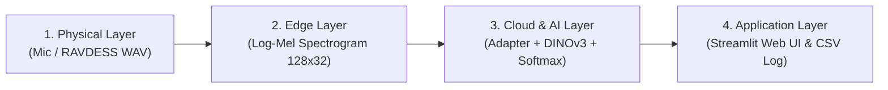

# 🎙️ Speech Emotion Recognition (SER) — DINOv3 & 4-Layer Architecture

## 1. Project Overview
An end-to-end **Speech Emotion Recognition (SER)** system designed to assist **clinical psychologists, mental health specialists, and individual users** in objectively evaluating emotional states from human speech. Users can record live voice streams via microphone or upload `.wav` audio files; the system automatically validates signal quality, extracts time-frequency acoustic representations using the self-supervised **DINOv3 Vision Foundation Model**, and outputs a 6-class emotion probability distribution prior to logging session records.

**Current Version Scope (v1.0.0):**
- Real-time voice recording via WebRTC Microphone or `.wav` file upload with automated Voice Activity Detection (VAD) quality checks.
- Edge-layer Log-Mel Spectrogram extraction ($128 \times 32$) and 6-class emotion classification (`Angry`, `Happy`, `Fear`, `Sad`, `Neutral`, `Surprise`) powered by **DINOv3**.
- Interactive clinical analytics displaying **Dominant Emotion**, **Expression Clarity (%)**, **Expression Pattern (Single vs. Blended)**, and **Secondary Emotion**.
- Automated session logging and `.CSV` report export for longitudinal tracking.
- **24/7 Live Cloud Deployment (Streamlit Cloud):** [https://9lanak96myhhnmym2kju4v.streamlit.app/](https://9lanak96myhhnmym2kju4v.streamlit.app/)

---

## 📑 Table of Contents
1. [Project Overview](#1-project-overview)
2. [System Overview (4-Layer Architecture)](#2-system-overview-4-layer-architecture)
3. [⭐ KEY ARCHITECTURAL UPDATES: DINOv3 & LOSS FUNCTION](#3--key-architectural-updates-dinov3--loss-function)
   - [3.1. Model Update: DINOv3 Backbone & 2D Spectrogram Adapter](#31-model-update-dinov3-backbone--2d-spectrogram-adapter)
   - [3.2. Stagewise Fine-Tuning Strategy (Selective Freezing)](#32-stagewise-fine-tuning-strategy-selective-freezing)
   - [3.3. Loss Function & Filtered Optimizer Updates](#33-loss-function--filtered-optimizer-updates)
   - [3.4. Multi-Dimensional Evaluation & Metrics Reporting](#34-multi-dimensional-evaluation--metrics-reporting)
4. [AI Model Specification](#4-ai-model-specification)
5. [Environment & Project Structure](#5-environment--project-structure)
6. [Setup (Installation Guide)](#6-setup-installation-guide)
7. [Run & Verify](#7-run--verify)
8. [Usage (Web Interface Workflow)](#8-usage-web-interface-workflow)
9. [Troubleshooting](#9-troubleshooting)

---

## 2. System Overview (4-Layer Architecture)

The system is engineered around a **4-Layer End-to-End Architecture**, connecting physical audio acquisition to cloud AI inference and web visualization:



- **1. Physical Layer (Client / Data Corpus):** Captures raw 1D audio signals from live user microphones or the benchmark **RAVDESS** dataset (partitioned via speaker-independent **Leave-One-Speaker-Out / LOSO** cross-validation) across 6 emotion classes: `Angry`, `Happy`, `Fear`, `Sad`, `Neutral`, `Surprise`.
- **2. Edge Preprocessing Layer (`step2_edge_preprocessing.py`):** Converts audio to single-channel Mono ($c = 1$), resamples to $16,000\text{ Hz}$, filters out silence via VAD, applies a pre-emphasis filter ($\alpha = 0.97$), computes 512-point STFT ($20\text{ ms}$ Hamming window, $10\text{ ms}$ hop length), extracts $32$ Log-Mel frequency bands, applies instance-level Z-Score normalization ($\mu = 0, \sigma = 1$), and slices/pads sequences into a fixed window of $d = 128$ frames to yield a multivariate time-series tensor $S \in \mathbb{R}^{128 \times 32}$.
- **3. Cloud & AI Layer (`step3_1d_swin_model.py`):** Projects the 1D time-series matrix into a 3-channel 2D time-frequency representation via a learnable `Spectrogram Adapter`, extracts 384-dimensional semantic embeddings using the self-supervised **DINOv3** backbone, and computes class probabilities via Softmax.
- **4. Application Layer (`step6_deploy_app.py`):** A single-screen **Streamlit** Web UI designed for clinicians and end-users to inspect signal quality, review emotion distribution tables, and export `.CSV` session logs (`emotion_analysis_records.csv`).

---

## 3. ⭐ KEY ARCHITECTURAL UPDATES: DINOv3 & LOSS FUNCTION

> [!IMPORTANT]
> This section details the core source-code improvements over the initial baseline (standard 1D Swin-Transformer).

### 3.1. Model Update: DINOv3 Backbone & 2D Spectrogram Adapter
- **Implementation File:** `step3_1d_swin_model.py` (Lines 11–95)
- **Class:** `DINOv3AudioSER`

#### A. Learnable 2D Spectrogram Adapter:
The Log-Mel tensor generated by the Edge Layer has shape $S \in \mathbb{R}^{B \times 128 \times 32}$. To bridge the modality gap and leverage a Vision Foundation Model, the tensor is transposed into a single-channel 2D time-frequency grid $(B, 1, 32, 128)$ and projected to 3 channels via a learnable $1 \times 1$ convolution and batch normalization block:

```python
# [step3_1d_swin_model.py: Lines 30-33]
self.spec_adapter = nn.Sequential(
    nn.Conv2d(in_channels=1, out_channels=3, kernel_size=1, bias=False),
    nn.BatchNorm2d(3),
)
```

Bilinear interpolation is then applied to resize the feature map to $(B, 3, 224, 224)$ to match the patch grid of the Vision Transformer:

```python
# [step3_1d_swin_model.py: Lines 80-86]
x_2d = s_1d.transpose(1, 2).unsqueeze(1)                # (B, 1, 32, 128)
x_rgb = self.spec_adapter(x_2d)                         # (B, 3, 32, 128)
x_resized = F.interpolate(
    x_rgb, size=(self.img_size, self.img_size), mode="bilinear", align_corners=False
)                                                       # (B, 3, 224, 224)
```

#### B. Loading the Pre-trained DINOv3 Foundation Encoder:
The `timm` library loads the self-supervised Vision Transformer backbone with an automated fallback mechanism:

```python
# [step3_1d_swin_model.py: Lines 35-48]
try:
    self.encoder = timm.create_model("vit_small_patch16_dinov3.lvd1689m", pretrained=True, num_classes=0)
    self.loaded_model_name = "vit_small_patch16_dinov3.lvd1689m"
except Exception:
    fallback_name = "vit_small_patch16_224.dino"
    self.encoder = timm.create_model(fallback_name, pretrained=True, num_classes=0)
    self.loaded_model_name = fallback_name

embed_dim = self.encoder.num_features  # 384 for ViT-Small
```

---

### 3.2. Stagewise Fine-Tuning Strategy (Selective Freezing)
- **Implementation File:** `step3_1d_swin_model.py` (Lines 51–70)

To prevent catastrophic forgetting on small-scale audio datasets and reduce GPU compute overhead by over 80%, all early feature extraction blocks are frozen (`requires_grad = False`), **unfreezing only the last 2 Transformer blocks** and the final normalization layer:

```python
# [step3_1d_swin_model.py: Lines 52-64]
if freeze_backbone:
    # 1. Freeze all backbone parameters
    for param in self.encoder.parameters():
        param.requires_grad = False

    # 2. Selectively unfreeze the last 2 Transformer blocks
    if hasattr(self.encoder, "blocks") and unfreeze_last_n_blocks > 0:
        for block in self.encoder.blocks[-unfreeze_last_n_blocks:]:
            for param in block.parameters():
                param.requires_grad = True

    # 3. Unfreeze the final LayerNorm layer
    if hasattr(self.encoder, "norm"):
        for param in self.encoder.norm.parameters():
            param.requires_grad = True
```

The lightweight classification head applies `LayerNorm`, `Dropout` regularization, and a linear projection to $k = 6$ emotion classes:

```python
# [step3_1d_swin_model.py: Lines 66-70]
self.classification_head = nn.Sequential(
    nn.LayerNorm(embed_dim),
    nn.Dropout(drop_rate),
    nn.Linear(embed_dim, num_classes),
)
```

---

### 3.3. Loss Function & Filtered Optimizer Updates
- **Implementation File:** `step4_train_pipeline.py` (Lines 25–35 and Lines 93–100)

#### A. Multi-Class Cross-Entropy Loss:
The objective function optimizes raw unnormalized `logits` against ground-truth class indices $y \in \{0, 1, \dots, 5\}$:

$$\mathcal{L}_{CE} = - \sum_{i=1}^{k} y_i \log(\hat{y}'_i)$$

```python
# [step4_train_pipeline.py: Line 94]
criterion = nn.CrossEntropyLoss()

# Inside train_one_epoch():
logits, probs = model(s_batch)
loss = criterion(logits, label_indices)
loss.backward()
optimizer.step()
```

#### B. Filtered Adam Optimizer:
The `Adam` optimizer filters model parameters to update only trainable weights (`requires_grad = True`, comprising `spec_adapter`, the last 2 Transformer blocks, and `classification_head`):

```python
# [step4_train_pipeline.py: Lines 96-100]
optimizer = optim.Adam(
    filter(lambda p: p.requires_grad, model.parameters()),
    lr=1e-4,
    weight_decay=1e-4,
)
```

---

### 3.4. Multi-Dimensional Evaluation & Metrics Reporting
- **Implementation File:** `step5_evaluate_dashboard.py`

The evaluation pipeline computes standard benchmark metrics for Speech Emotion Recognition:
- **WAR (Weighted Average Recall / Overall Accuracy):** Measures overall classification accuracy across the test set.
- **UAR (Unweighted Average Recall / Macro Recall):** Measures balanced per-class recall regardless of class imbalance.
- **Macro Average ROC-AUC:** Evaluates multi-class probability separability.
- **Normalized Confusion Matrix:** Automatically exports a row-normalized $6 \times 6$ confusion matrix figure to `dashboard_outputs/confusion_matrix_ravdess.png`.

---

## 4. AI Model Specification

| Attribute | Technical Specification |
| :--- | :--- |
| **Model Name / Version** | `DINOv3AudioSER` (`v1.0.0`) — Backbone `vit_small_patch16_dinov3.lvd1689m` |
| **Model Artifacts** | • Full Checkpoint: `emo_db_storage/checkpoints/best_dinov3_ser.pth` (~85 MB)<br/>• Compact Cloud Delta: `emo_db_storage/checkpoints/best_dinov3_compact.pth` (~14 MB) |
| **AI Task** | Multivariate Time-Series Classification / Speech Emotion Recognition ($k = 6$ classes) |
| **Input Specification** | Uncompressed `.wav` file or live WebRTC audio stream (standardized to Mono, $16,000\text{ Hz}$, duration $\ge 0.1\text{ s}$). Edge output tensor: $S \in \mathbb{R}^{B \times 128 \times 32}$ |
| **Output Specification** | Raw `logits` $\hat{y} \in \mathbb{R}^{B \times 6}$ and `Softmax` probability vector $\hat{y}' \in \mathbb{R}^{B \times 6}$ |
| **Decision Thresholds** | • **Input VAD Gate:** Rejects audio if sample count $< 1,600$ ($<0.1\text{ s}$) or peak amplitude $< 10^{-4}$.<br/>• **Expression Clarity:** $\ge 70\%$ (*High Clarity - OK*) \| $45\% - 70\%$ (*Moderate Clarity*) \| $< 45\%$ (*Low Clarity / Subtle - UNCERTAIN*).<br/>• **Expression Pattern:** Margin $\text{Top}_1 - \text{Top}_2 \ge 25\%$ $\rightarrow$ *Single Dominant Emotion*; $< 25\%$ $\rightarrow$ *Blended Emotion*. |
| **Known Limitations** | • Performance may degrade under heavy background noise (wind, traffic) or overlapping speech.<br/>• The fixed center window analyzes $128\text{ frames}$ ($\approx 1.28\text{ s}$), making $2 - 5\text{ s}$ utterances optimal. |

---

## 5. Environment & Project Structure

### 5.1. System Requirements (Prerequisites)

| Component | Version / Requirement | Notes |
| :--- | :--- | :--- |
| **Operating System** | Windows 10/11 (64-bit), Ubuntu 22.04 LTS | Tested on Windows 11 Local & Linux Cloud |
| **Python** | `3.10.x` or `3.11.x` | Recommended: `Python 3.11.9` |
| **Hardware** | 4-Core CPU minimum, RAM $\ge 8\text{ GB}$ | NVIDIA GPU (CUDA 12.4) recommended for `step4` training |
| **Disk Space** | $\ge 2.5\text{ GB}$ free storage | For RAVDESS audio corpus and model checkpoints |
| **Model Weights** | Placed in `emo_db_storage/checkpoints/` | Loads `best_dinov3_compact.pth` (14MB) or `best_dinov3_ser.pth` |

### 5.2. Directory Structure

```text
1D_Swin_Transformer/
├── data/RAVDESS/                         # Raw audio corpus (Actor_01 .. Actor_24)
├── emo_db_storage/
│   ├── checkpoints/
│   │   ├── best_dinov3_ser.pth           # Full trained checkpoint (~85 MB)
│   │   └── best_dinov3_compact.pth       # Trainable-delta compact weights for Cloud (~14 MB)
│   └── logs/
│       └── emotion_analysis_records.csv  # Session inference logs from the Web UI
├── dashboard_outputs/                    # Evaluation metrics (.txt) & Confusion Matrix (.png)
├── step1_data_collector.py               # Step 1: RAVDESS downloader & LOSO splitter
├── step2_edge_preprocessing.py           # Step 2: Edge Log-Mel Spectrogram preprocessing
├── step3_1d_swin_model.py                # Step 3: DINOv3 architecture & Spectrogram Adapter
├── step4_train_pipeline.py               # Step 4: Training loop (CrossEntropyLoss + Adam)
├── step5_evaluate_dashboard.py           # Step 5: WAR/UAR evaluation & Confusion Matrix plot
├── step6_deploy_app.py                   # Step 6: Single-page Streamlit Web Application
├── step7_publish_cloud.py                # Step 7: Delta checkpoint compression & cloud bundler
├── requirements.txt                      # Pinned Python dependencies
└── README.md                             # Project documentation & setup guide
```

---

## 6. Setup (Installation Guide)

Run the following commands sequentially in your terminal:

### Step 1: Clone the repository and navigate to the project root
```bash
git clone [https://github.com/dangdinhdung3010/ser.git](https://github.com/dangdinhdung3010/ser.git)
cd ser
```

### Step 2: Create and activate a virtual environment (`.venv`)
- **Windows (PowerShell):**
  ```powershell
  python -m venv .venv
  .\.venv\Scripts\activate
  ```
- **macOS / Linux (Bash):**
  ```bash
  python3 -m venv .venv
  source .venv/bin/activate
  ```

### Step 3: Install required dependencies
```bash
pip install -r requirements.txt
```

**Post-Setup Verification:**
Verify that PyTorch, Streamlit, and `timm` are properly installed:
```bash
python -c "import torch, streamlit, timm; print('Env OK | CUDA:', torch.cuda.is_available())"
```
Expected output:
```text
Env OK | CUDA: True (or False on CPU-only machines)
```

---

## 7. Run & Verify

### 7.1. Launch the Web Application (For End-Users & Reviewers)
From the project root directory, run:
```bash
streamlit run step6_deploy_app.py
```
**Expected output:**
```text
  You can now view your Streamlit app in your browser.
  Local URL: http://localhost:8501
```

### 7.2. Verify the End-to-End Training & Evaluation Pipeline (`step1` $\rightarrow$ `step5`)

- **Step 1 — Dataset Collection & LOSO Split:**
  ```bash
  python step1_data_collector.py
  ```
  *Expected output:* Downloads/extracts `./data/RAVDESS` and prints the sample counts for Train (23 Actors) and Test (1 Actor).

- **Step 2 — Edge Preprocessor Verification:**
  ```bash
  python step2_edge_preprocessing.py
  ```
  *Expected output:* `Output 1D Time-Series Tensor shape: torch.Size([128, 32])`.

- **Step 3 — DINOv3 Model & Adapter Verification:**
  ```bash
  python step3_1d_swin_model.py
  ```
  *Expected output:* Displays loaded backbone name, trainable parameter count, and output shapes `Logits: torch.Size([2, 6]), Probs: torch.Size([2, 6])`.

- **Step 4 — Model Training:**
  ```bash
  python step4_train_pipeline.py
  ```
  *Expected output:* Logs epoch progress (`Epoch [1/N] ... Train Loss | Val WAR | Val UAR`) and saves `./emo_db_storage/checkpoints/best_dinov3_ser.pth`.

- **Step 5 — Academic Evaluation & Confusion Matrix Generation:**
  ```bash
  python step5_evaluate_dashboard.py
  ```
  *Expected output:* Prints `WAR, UAR, Macro F1, ROC-AUC` metrics to the console and saves `dashboard_outputs/confusion_matrix_ravdess.png`.

---

## 8. Usage (Web Interface Workflow)

Once the application is open at `http://localhost:8501` (or via the live Cloud URL `https://9lanak96myhhnmym2kju4v.streamlit.app/`):
1. **Enter Subject Identifier (Optional):** Fill in the *Record ID / Subject Name* field (e.g., `BN-012`) in the left panel.
2. **Provide Audio Input:**
   - Select **🎤 Ghi âm trực tiếp (Live Recording)**: Click the microphone icon and speak naturally for $2 - 5\text{ seconds}$.
   - Or select **📁 Tải file ghi âm (.wav) (Upload WAV)**: Upload an existing `.wav` audio file from your device.
3. **Trigger AI Analysis:** Click the **`🔍 Thực hiện Phân tích Cảm xúc`** button. *(Note: Inference only runs when explicitly triggered by clicking this button).*
4. **Inspect Results:**
   - Review the **Recording Quality Assessment** card on the left (Sample status, Duration, Volume intensity, Speech pacing).
   - Review the **4 Primary Emotion KPI Cards** and the **6-Class Emotion Distribution Table** on the right.
5. **Export Clinical History:** Expand **`📁 4. Lịch sử các Phiên Phân tích Cảm xúc`** at the bottom and click **`⬇ Tải Báo cáo Lịch sử Phân tích (.CSV / Excel)`**.

---

## 9. Troubleshooting

| Issue / Error Code | Probable Cause | Solution |
| :--- | :--- | :--- |
| **`ModuleNotFoundError: No module named '...'`** | Virtual environment `.venv` is not activated or packages are missing. | Activate `.venv` and run `pip install -r requirements.txt`. |
| **Warning: `Mẫu ghi âm chưa đủ độ dài hoặc quá nhỏ`** | Audio duration is $< 0.1\text{ s}$ or peak amplitude is $< 10^{-4}$ (blocked by the VAD filter). | Grant browser microphone permissions and speak clearly for $2 - 5\text{ seconds}$. |
| **No results shown after selecting a `.wav` file** | The UI uses human-triggered execution to prevent unintended auto-runs. | Click the blue **`🔍 Thực hiện Phân tích Cảm xúc`** button after uploading or recording. |
| **`Port 8501 is already in use`** | Another Streamlit instance is already running on port 8501. | Terminate the existing terminal process or run `streamlit run step6_deploy_app.py --server.port 8502`. |
| **Checkpoint `.pth` not found on Cloud** | `best_dinov3_compact.pth` was not committed to `emo_db_storage/checkpoints/`. | Run `python step7_publish_cloud.py` to generate the 14MB compact checkpoint and push it to GitHub. |

---
**Maintainer & Versioning:**
- **Author:** AI & Data Science Major (AI&DS)
- **Model & Documentation Version:** `v1.0.0` (Last Updated: November 2026)
