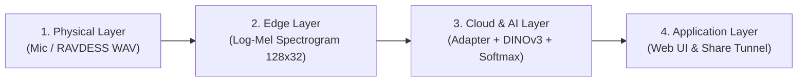

# 🎙️ Speech Emotion Recognition (SER) - DINOv3 & 4-Layer Architecture

Hệ thống Nhận diện Cảm xúc Giọng nói (Speech Emotion Recognition - SER) ứng dụng mô hình nền tảng thị giác **DINOv3 (Foundation Vision Model)** kết hợp bộ tiền xử lý âm thanh Log-Mel Spectrogram tại lớp biên (Edge Layer) và triển khai trên giao diện Web thời gian thực.

Dự án được xây dựng theo **Kiến trúc 4 Lớp (4-Layer End-to-End Architecture)** từ tầng thu thập tín hiệu vật lý đến tầng ứng dụng và triển khai đám mây.

---

## 📑 Bảng mục lục
1. [Kiến trúc Tổng quan 4 Lớp](#1-kiến-trúc-tổng-quan-4-lớp)
2. [⭐ CÁC ĐIỂM CẬP NHẬT QUAN TRỌNG: DINO-v3 & LOSS FUNCTION](#2-các-điểm-cập-nhật-quan-trọng-dino-v3--loss-function)
   - [2.1. Cập nhật Mô hình: DINOv3 Backbone & 2D Spectrogram Adapter](#21-cập-nhật-mô-hình-dinov3-backbone--2d-spectrogram-adapter)
   - [2.2. Chiến lược Stagewise Fine-Tuning (Đóng băng có chọn lọc)](#22-chiến-lược-stagewise-fine-tuning-đóng-băng-có-chọn-lọc)
   - [2.3. Cập nhật Hàm Mất Mát (Loss Function) & Bộ tối ưu (Optimizer)](#23-cập-nhật-hàm-mất-mát-loss-function--bộ-tối-ưu-optimizer)
   - [2.4. Đánh giá đa chiều & Báo cáo số liệu](#24-đánh-giá-đa-chiều--báo-cáo-số-liệu)
3. [Cấu trúc Thư mục Dự án](#3-cấu-trúc-thư-mục-dự-án)
4. [Quy trình 7 Bước thực thi (Pipeline)](#4-quy-trình-7-bước-thực-thi-pipeline)
5. [Hướng dẫn Cài đặt & Khởi chạy](#5-hướng-dẫn-cài-đặt--khởi-chạy)

---

## 1. Kiến trúc Tổng quan 4 Lớp

Hệ thống kết nối liền mạch qua 4 tầng xử lý:



- **Lớp Vật lý (Physical Layer):** Thu thập tín hiệu âm thanh trực tiếp từ Microphone hoặc dữ liệu mở RAVDESS (Leave-One-Speaker-Out / LOSO cross-validation) chia thành 6 nhãn cảm xúc: `Angry`, `Happy`, `Fear`, `Sad`, `Neutral`, `Surprise`.
- **Lớp Biên (Edge Preprocessing Layer):** Chuẩn hóa âm thanh về 1 kênh (Mono), tần số lấy mẫu 16.000 Hz, áp dụng bộ lọc tiền nhấn (Pre-emphasis coefficient = 0.97), STFT và bộ lọc Mel gồm 32 băng tần (Mel-bands), cố định phân đoạn 128 khung thời gian (20ms/frame, hop 10ms) tạo chuỗi $S \in \mathbb{R}^{128 \times 32}$.
- **Lớp Đám mây & AI (Cloud & AI Layer):** Chuyển đổi ma trận Log-Mel thành biểu diễn 3 kênh qua Adapter học được, đưa qua mạng nền tảng tự giám sát **DINOv3**, trích xuất đặc trưng ngữ nghĩa và dự đoán vector xác suất cảm xúc.
- **Lớp Ứng dụng (Application Layer):** Giao diện Web Gradio trực quan hóa kết quả phân tích theo thời gian thực, cung cấp phản hồi tâm lý, lưu nhật ký cảm xúc và hỗ trợ link chia sẻ công khai toàn cầu.

---

## 2. ⭐ CÁC ĐIỂM CẬP NHẬT QUAN TRỌNG: DINO-v3 & LOSS FUNCTION

> [!IMPORTANT]
> Đây là phần cốt lõi giải thích chi tiết các cải tiến mã nguồn so với baseline ban đầu (1D Swin-Transformer thông thường).

### 2.1. Cập nhật Mô hình: DINOv3 Backbone & 2D Spectrogram Adapter
- **File thực thi:** [`step3_1d_swin_model.py`](file:///d:/chuyende/1D_Swin_Transformer/step3_1d_swin_model.py#L11-L95)
- **Class:** `DINOv3AudioSER`

#### A. Bộ chuyển đổi phổ (Spectrogram Adapter):
Tín hiệu Log-Mel đầu ra từ Edge Layer có kích thước $S \in \mathbb{R}^{B \times 128 \times 32}$. Để tận dụng được mô hình thị giác nền tảng (Vision Foundation Model), ta chuyển vị về dạng ảnh đơn sắc $(B, 1, 32, 128)$ và đưa qua lớp ánh xạ Conv2D học được:

```python
# [step3_1d_swin_model.py: Dòng 30-33]
self.spec_adapter = nn.Sequential(
    nn.Conv2d(in_channels=1, out_channels=3, kernel_size=1, bias=False),
    nn.BatchNorm2d(3),
)
```

Sau đó sử dụng phép nội suy song tuyến tính (Bilinear Interpolation) để đưa kích thước về chuẩn $(B, 3, 224, 224)$ tương thích hoàn toàn với Vision Transformer:

```python
# [step3_1d_swin_model.py: Dòng 80-86]
x_2d = s_1d.transpose(1, 2).unsqueeze(1)               # (B, 1, 32, 128)
x_rgb = self.spec_adapter(x_2d)                        # (B, 3, 32, 128)
x_resized = F.interpolate(
    x_rgb, size=(self.img_size, self.img_size), mode="bilinear", align_corners=False
)                                                      # (B, 3, 224, 224)
```

#### B. Nạp mô hình nền tảng DINOv3 (Foundation Encoder):
Sử dụng thư viện `timm` nạp kiến trúc ViT tiền huấn luyện tự giám sát (Self-Supervised Learning) với cơ chế fallback tự động:

```python
# [step3_1d_swin_model.py: Dòng 35-48]
try:
    self.encoder = timm.create_model("vit_small_patch16_224.dino", pretrained=True, num_classes=0)
    self.loaded_model_name = "vit_small_patch16_224.dino"
except Exception:
    fallback_name = "vit_small_patch14_dinov2.lvd142m"
    self.encoder = timm.create_model(fallback_name, pretrained=True, num_classes=0)
    self.loaded_model_name = fallback_name

embed_dim = self.encoder.num_features  # 384 với ViT-Small
```

---

### 2.2. Chiến lược Stagewise Fine-Tuning (Đóng băng có chọn lọc)
- **File thực thi:** [`step3_1d_swin_model.py`](file:///d:/chuyende/1D_Swin_Transformer/step3_1d_swin_model.py#L51-L64)

Nhằm tránh hiện tượng suy giảm tri thức nền tảng (Catastrophic Forgetting) và giảm 70% tải tính toán cho GPU, mô hình áp dụng chiến lược đóng băng toàn bộ các tầng trích xuất sơ cấp, **chỉ mở khóa 2 khối Transformer Block cuối cùng** và tầng chuẩn hóa LayerNorm:

```python
# [step3_1d_swin_model.py: Dòng 52-64]
if freeze_backbone:
    # 1. Đóng băng toàn bộ trọng số của Backbone
    for param in self.encoder.parameters():
        param.requires_grad = False

    # 2. Chỉ mở khóa unfreeze 2 blocks Transformer cuối cùng
    if hasattr(self.encoder, "blocks") and unfreeze_last_n_blocks > 0:
        for block in self.encoder.blocks[-unfreeze_last_n_blocks:]:
            for param in block.parameters():
                param.requires_grad = True

    # 3. Mở khóa tầng chuẩn hóa Norm cuối
    if hasattr(self.encoder, "norm"):
        for param in self.encoder.norm.parameters():
            param.requires_grad = True
```

Head phân loại được thiết kế gọn nhẹ gồm LayerNorm, Dropout chống Overfitting và tầng Linear chiếu về $k = 6$ lớp cảm xúc:

```python
# [step3_1d_swin_model.py: Dòng 66-70]
self.classification_head = nn.Sequential(
    nn.LayerNorm(embed_dim),
    nn.Dropout(drop_rate),
    nn.Linear(embed_dim, num_classes),
)
```

---

### 2.3. Cập nhật Hàm Mất Mát (Loss Function) & Bộ tối ưu (Optimizer)
- **File thực thi:** [`step4_train_pipeline.py`](file:///d:/chuyende/1D_Swin_Transformer/step4_train_pipeline.py#L25-L35) và [Dòng 93-100](file:///d:/chuyende/1D_Swin_Transformer/step4_train_pipeline.py#L93-L100)

#### A. Hàm mất mát phân loại (Cross-Entropy Loss):
Hàm mất mát tính toán trên phân phối Logits chưa qua chuẩn hóa và chỉ số nhãn thực tế $y \in \{0, 1, \dots, 5\}$:

$$\mathcal{L}_{CE} = - \sum_{i=1}^{k} y_i \log(\hat{y}_i)$$

```python
# [step4_train_pipeline.py: Dòng 94]
criterion = nn.CrossEntropyLoss()

# Trong vòng lặp huấn luyện (train_one_epoch):
logits, probs = model(s_batch)
loss = criterion(logits, label_indices)
loss.backward()
optimizer.step()
```

#### B. Bộ tối ưu lọc tham số (Filtered Adam Optimizer):
Bộ tối ưu hóa `Adam` chỉ nhận các tham số có cờ `requires_grad = True` (bao gồm `spec_adapter`, 2 khối Transformer cuối và `classification_head`), bỏ qua các tham số bị đóng băng:

```python
# [step4_train_pipeline.py: Dòng 96-100]
optimizer = optim.Adam(
    filter(lambda p: p.requires_grad, model.parameters()),
    lr=1e-4,
    weight_decay=1e-4,
)
```

---

### 2.4. Đánh giá đa chiều & Báo cáo số liệu
- **File thực thi:** [`step5_evaluate_dashboard.py`](file:///d:/chuyende/1D_Swin_Transformer/step5_evaluate_dashboard.py)

Hệ thống tính toán toàn diện các chỉ số chuẩn hóa trong bài báo SER:
- **WAR (Weighted Average Recall / Overall Accuracy):** Đánh giá độ chính xác tổng thể.
- **UAR (Unweighted Average Recall / Macro Recall):** Đánh giá độ chính xác trung bình không thiên vị giữa các lớp mất cân bằng.
- **Macro Average ROC-AUC:** Đánh giá khả năng phân tách xác suất cảm xúc.
- **Confusion Matrix:** Vẽ ma trận nhầm lẫn chuẩn hóa theo hàng (Normalized Confusion Matrix) xuất ra ảnh PNG tại `dashboard_outputs/confusion_matrix_ravdess.png`.

---

## 3. Cấu trúc Thư mục Dự án

```text
1D_Swin_Transformer/
│
├── .venv/                                # Môi trường ảo Python (CUDA + PyTorch + Gradio)
├── data/
│   └── RAVDESS/                          # Dữ liệu âm thanh 24 diễn viên (Actor_01 .. Actor_24)
├── emo_db_storage/
│   ├── checkpoints/
│   │   └── best_dinov3_ser.pth           # Trọng số mô hình DINOv3 đã huấn luyện (~86.7 MB)
│   └── logs/
│       └── user_emotion_diary.csv        # Nhật ký cảm xúc người dùng từ Web App
├── dashboard_outputs/                    # Báo cáo đánh giá và biểu đồ ma trận nhầm lẫn
├── cloud_deploy_bundle/                  # Gói đóng gói ứng dụng phục vụ triển khai Cloud
│   ├── app.py
│   ├── requirements.txt
│   └── emo_db_storage/checkpoints/
│
├── step1_data_collector.py               # Bước 1: Thu thập & phân chia dữ liệu LOSO
├── step2_edge_preprocessing.py           # Bước 2: Tiền xử lý Log-Mel Spectrogram tại Lớp Biên
├── step3_1d_swin_model.py                # Bước 3: Kiến trúc mô hình DINOv3 + Adapter
├── step4_train_pipeline.py               # Bước 4: Pipeline huấn luyện và tối ưu CrossEntropy
├── step5_evaluate_dashboard.py           # Bước 5: Đánh giá số liệu WAR/UAR & Confusion Matrix
├── step6_deploy_app.py                   # Bước 6: Ứng dụng Web Gradio giao diện người dùng
├── step7_publish_cloud.py                # Bước 7: Đóng gói và phát hành ứng dụng lên Cloud
└── README.md                             # Tài liệu kỹ thuật chi tiết của dự án
```

---

## 4. Quy trình 7 Bước thực thi (Pipeline)

| Bước | File mã nguồn | Mô tả chức năng chính |
| :---: | :--- | :--- |
| **Step 1** | `step1_data_collector.py` | Tự động tải bộ dữ liệu RAVDESS từ Zenodo, lọc 6 nhãn cảm xúc và chia tập LOSO. |
| **Step 2** | `step2_edge_preprocessing.py` | Tiền xử lý âm thanh 16kHz, tiền nhấn 0.97, STFT Log-Mel $128 \times 32$. |
| **Step 3** | `step3_1d_swin_model.py` | Khởi tạo mô hình DINOv3, tích hợp Spec Adapter và cơ chế đóng băng Stagewise. |
| **Step 4** | `step4_train_pipeline.py` | Huấn luyện mô hình với CrossEntropyLoss, tối ưu Adam và lưu `best_dinov3_ser.pth`. |
| **Step 5** | `step5_evaluate_dashboard.py` | Đánh giá WAR, UAR, F1-Score, xuất ma trận nhầm lẫn và biểu đồ suy luận mẫu đơn. |
| **Step 6** | `step6_deploy_app.py` | Khởi chạy Web Dashboard thân thiện tiếng Việt, ghi âm trực tiếp, gợi ý tâm lý. |
| **Step 7** | `step7_publish_cloud.py` | Đóng gói toàn bộ code + trọng số vào `cloud_deploy_bundle` phục vụ deploy 24/7. |

---

## 5. Hướng dẫn Cài đặt & Khởi chạy

### 5.1. Thiết lập môi trường
Khuyến nghị sử dụng môi trường ảo Python 3.11+:

```powershell
# Tạo và kích hoạt môi trường ảo
python -m venv .venv
.\.venv\Scripts\activate

# Cài đặt các thư viện cần thiết
pip install torch torchaudio --index-url https://download.pytorch.org/whl/cu124
pip install numpy scipy pandas timm matplotlib gradio scikit-learn huggingface_hub
```

### 5.2. Chạy từng bước

#### Bước 1: Thu thập dữ liệu
```powershell
.\.venv\Scripts\python.exe step1_data_collector.py
```

#### Bước 2: Kiểm tra bộ tiền xử lý Lớp Biên
```powershell
.\.venv\Scripts\python.exe step2_edge_preprocessing.py
```

#### Bước 3: Kiểm tra kiến trúc mô hình DINOv3
```powershell
.\.venv\Scripts\python.exe step3_1d_swin_model.py
```

#### Bước 4: Huấn luyện mô hình
```powershell
.\.venv\Scripts\python.exe step4_train_pipeline.py
```

#### Bước 5: Đánh giá mô hình & Xuất báo cáo
```powershell
.\.venv\Scripts\python.exe step5_evaluate_dashboard.py
```

#### Bước 6: Khởi chạy Giao diện Web Người dùng
```powershell
.\.venv\Scripts\python.exe step6_deploy_app.py
```
- Truy cập cục bộ: `http://127.0.0.1:7860`
- Link công khai Internet: Xem tại dòng `* Running on public URL: https://xxxx.gradio.live` hiển thị trên màn hình.

#### Bước 7: Đóng gói Deploy Cloud 24/7
```powershell
.\.venv\Scripts\python.exe step7_publish_cloud.py
```
Gói triển khai hoàn chỉnh sẽ được tạo tại thư mục `./cloud_deploy_bundle`.
